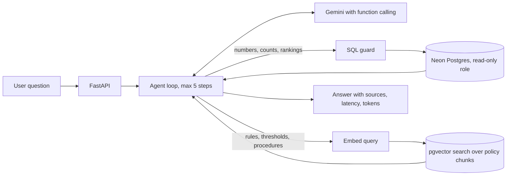

# Supply Chain Planning Intelligence Platform

Ask questions in plain English about supply chain planning data and company planning policies.
A Gemini agent decides whether to query the database, search the policy documents, or both, and answers with sources.

**Live demo:** https://scm-intelligence-platform.vercel.app

Example questions:
- Which class A items have the most SHORTAGE exceptions?
- How quickly must we act on a HIGH shortage for a class A item?
- How many class B items are there, and what MAPE target applies to class B?
- What are our supplier payment terms? (not covered, so it says so instead of guessing)

All data is synthetic. The company, Northwind Industrial Systems, is fictional.

## How it works



- **Two tools.** `query_planning_db` runs one SQL SELECT. `search_documents` finds policy passages by meaning.
  The model chooses, and can use both for mixed questions such as "how many class A items are there, and what safety stock target applies to them".
- **Manual agent loop.** No agent framework. The loop is a short function in `app.py`, with a step cap, model fallback and retries for temporary overloads.
- **SQL safety in two layers.** `sql_guard.py` rejects anything that is not a single SELECT (30 attack tests).
  Queries then run as a database user that only has SELECT, with a row cap and a 5 second timeout.
- **RAG.** Eight policy documents are split by section, embedded with `gemini-embedding-001` (768 dimensions) and stored in Postgres with pgvector.
  Search uses cosine distance with an HNSW index. Answers name the policy and section they came from.
- **Abstains when unsure.** If the retrieved passages do not answer the question, the agent says the policies do not cover it.

## Evaluation

Every expected answer is computed from the data files or taken from the policy text. No AI judge is used, so results are repeatable.
Scoring checks the facts and numbers in the answer, the tools used, the cited document and section, and the rows returned by the SQL.

| Question set | Questions | First run | After fixing scoring bugs |
|---|---|---|---|
| Standard (data, policy, mixed, not covered, safety) | 47 | 46/47 (98%) | 47/47 |
| Hard (typos, vague wording, false premises, math, boundary cases, prompt injection) | 27 | 18/27 (67%) | 27/27 |

How to read this honestly: every first-run failure turned out to be a bug in my scorer, not a wrong answer from the agent
(a minus sign on a shortage quantity, a missing "no section expected" case, and an answer phrase list that was too narrow).
The original scores are kept here on purpose. So far the sets have not found a real agent failure, which means they are good regression protection but not proof of perfection.
Known weak spot not yet tested: the policies describe HIGH and MEDIUM shortage severity in a way that can be read two ways.

Other numbers:
- Median latency: 3.2 s (standard set), 3.6 s (hard set). Slowest: 11.5 s.
- About 2,500 tokens per question.
- 71 offline unit tests with a fake model and fake database (run in about a second, free).
- Policy retrieval found the expected document in 33 of 33 checks.

Run it yourself:
```
py run_evals.py --name baseline
py run_evals.py --name hard --golden golden_hard.json
```
Results are saved in `evals/results/`.

## Stack

Python 3.12, FastAPI, Pydantic, Neon serverless Postgres with pgvector, Google Gemini API (free tier), Vercel, pytest.
Total cost to build and host: 0 dollars.

## Run it locally (Windows PowerShell)

```
py -m pip install -r requirements.txt
$env:DATABASE_URL="<owner connection string>"
$env:GEMINI_API_KEY="<your key>"
py generate_data.py
py load_data.py
py ingest_docs.py
```
Create the read-only user with `sql/00_readonly_role.sql`, then:
```
$env:DATABASE_URL_RO="<read-only connection string>"
py -m uvicorn app:app --reload
```
Open http://127.0.0.1:8000. Tests: `py -m pytest -q`.

## Project layout

| Path | Purpose |
|---|---|
| `app.py` | API, agent loop, web page |
| `sql_guard.py` | SQL validation |
| `retrieval.py`, `embeddings.py`, `chunking.py`, `ingest_docs.py` | RAG pipeline |
| `generate_data.py`, `load_data.py`, `sql/` | Synthetic data and database setup |
| `docs/policies/` | The eight policy documents |
| `evals/`, `run_evals.py`, `build_golden.py`, `build_hard.py` | Evaluation sets and scorer |
| `ratelimit.py` | Per visitor and daily limits for the public demo |

## Limitations

- Synthetic data and fictional policies, so this demonstrates the approach, not real planning results.
- Free tiers: Gemini has small daily quotas and occasional overloads (the agent falls back across three models), and the demo has soft rate limits.
- The daily cap is counted per server instance on serverless hosting, so it is a soft guard.
- Single-turn questions only. There is no conversation memory.
- The agent can read the planning database but cannot change anything, by design.

## Next

Hybrid keyword and vector search, request tracing, an MCP server wrapping the two tools, and a harder evaluation set aimed at the severity wording.

Built by Vivek Reddy Yasa.
